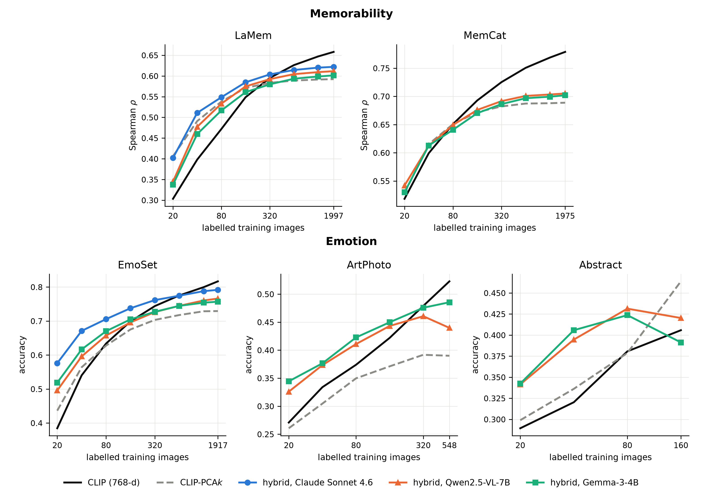
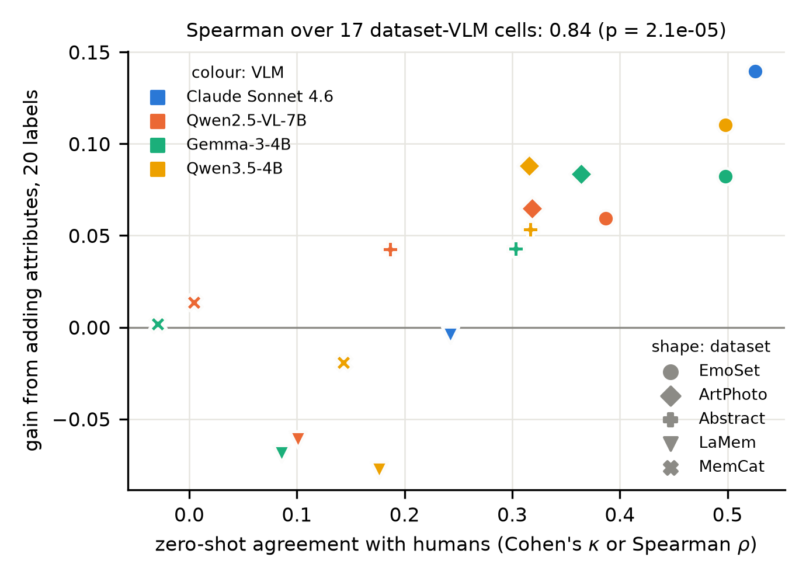

# Complement, Don't Replace

Code and data release for:

> Hamit Soyel. **Complement, Don't Replace: Vision-Language Model Attributes Add to a Frozen Encoder
> Where the Model Can Perceive the Target.** Under review.

## The result in one paragraph

We ask when a vision-language model's (VLM's) output improves a predictor of a subjective image property
trained from few labels. On **five datasets** (EmoSet, ArtPhoto and Abstract for evoked emotion; LaMem and
MemCat for memorability), with **four VLMs** (Claude Sonnet 4.6, and the open-weights Qwen2.5-VL-7B,
Gemma-3-4B and Qwen3.5-4B) and up to 2,000 labels, we compare direct VLM rating, a head on VLM-extracted
perceptual attributes, a head on a frozen CLIP embedding, a label-free compression of that embedding, and the
compression with the attributes appended. The main comparisons use **30 training subsets per budget**, a
two-level bootstrap, and **Holm correction over 472 contrasts**. The attributes are **not a substitute** for
the encoder: from 160 labels no attribute vector beats the equally compact compression after Holm correction. They
are a **complement where the VLM perceives the target**: for emotion, appending them to the compression
improves accuracy at every label budget with every VLM on EmoSet (**+5.9 to +14.0 points at 20 labels**); for
memorability, which no VLM rates well zero-shot (ρ ≤ 0.243), they add little or nothing with few labels (with the
open models on LaMem they lower ρ at 20 labels).
Across the 17 dataset and VLM pairs, the gain at 20 labels tracks the VLM's zero-shot agreement with human
labels (**Spearman 0.84**, p = 2 × 10⁻⁵; the relation was found on the first 12 pairs, after the first predictions
below were fixed). Two sets of predictions were fixed in advance. For the three datasets added last, four were written
down before any VLM label, CLIP feature or result existed (`PREREGISTRATION_new_datasets.md`); three were confirmed and one (the
small-budget gain against the equal-size code, which failed on Abstract and in one ArtPhoto cell) was not. For the
fourth VLM, **Qwen3.5-4B**, five were committed to this repository (commit `514b884`, `PREREGISTRATION_qwen35.md`)
before the model was downloaded or produced any output; four were confirmed, including the 17-pair relation
(threshold 0.70), and one was not: its rank in gain among the VLMs matched its rank in zero-shot agreement on EmoSet
and Abstract but not on ArtPhoto, LaMem or MemCat. In this study zero-shot agreement separated the target the VLMs
perceive (emotion) from the one they do not (memorability); it does not rank VLMs whose agreement is similar or uniformly
weak.





## Quick reproduction (CPU, no API key)

Every VLM output and image list is included (one Qwen3.5-4B direct rating counted invalid is kept apart in `checks/`; see
[Fourth VLM](#fourth-vlm-qwen35-4b-and-its-pre-registration)), and the CLIP embeddings of LaMem, ArtPhoto, Abstract and MemCat.
Two pieces must come from the original datasets:

- **EmoSet** does not allow redistributing derived data, so its CLIP embeddings and the label file of its 20,000-image
  pool are not included. Download [EmoSet](https://vcc.tech/EmoSet), set `EMOSET_IMAGE_DIR` in `extract_features.py`
  and run `python extract_features.py emoset` (about 30 minutes on a laptop CPU); the image lists in `samples/` fix
  which images are used and in which order. Regenerated embeddings match ours to within 5 × 10⁻⁶ per coordinate.
  With 20 to 40 labels the inner cross-validation can then choose a different regularization strength on some training
  subsets, so EmoSet numbers at the smallest budgets can move by up to about 0.6 points (for example +14.5 instead of
  +14.0 points for Claude's added-information gain at 20 labels); no conclusion changes. Our exact EmoSet embedding files
  are available on request to researchers who have accepted EmoSet's terms. Every other number reproduces exactly.
- **MemCat**'s scores are not copied here: download `memcat_image_data.csv` from the
  [MemCat OSF project](https://osf.io/kvghu/) (CC BY 4.0) and point `MEMCAT_CSV` at it.

```bash
pip install -r requirements.txt
# main results, EmoSet and LaMem (Tables 2-4, A.9; Sections 5.1-5.4)
for v in claude qwen gemma qwen35; do REPS=30 PROBE=linear python analysis.py $v; done
# non-linear probe (Section 5.9)
for v in claude qwen; do REPS=10 PROBE=mlp python analysis.py $v; done
# new datasets: ArtPhoto, Abstract, MemCat (Sections 5.2-5.5)
for v in qwen gemma qwen35; do MEMCAT_CSV=/path/to/memcat_image_data.csv VLMS=qwen,gemma,qwen35 REPS=30 python analysis_new.py $v; done
python check_predictions.py         # verdict on the predictions fixed in advance for the new datasets, P1-P4 (Table 5)
python make_assets.py               # tables/tab_{direct,added,vsclip,subst,equal,prereg}.tex, their JSON sources, figures/
python check_predictions_qwen35.py  # verdict on Q1-Q5 for Qwen3.5-4B (Table 6); needs tables/zero_shot.json from make_assets.py
python check_qwen35_records.py      # Qwen3.5-4B record checks of Supplementary S6 and S7 (results/qwen35_record_checks.json)
```

Each `analysis.py` run takes about an hour on a laptop CPU (the MLP runs longer). Outputs are identical to
the files in `results/`. `multitest.py` applies Holm and Benjamini-Hochberg corrections to any set of result
files; `make_assets.py` applies them over the whole study (`tables/family_holm.json`, 472 contrasts) and writes
`tables/zero_shot.json` and `tables/rule.json` (the 17-pair relation, with the 12-pair value without Qwen3.5-4B, the
values within emotion and within memorability, and the five Qwen3.5-4B pairs alone).
`check_predictions_qwen35.py` writes `results/predictions_qwen35_verdict.json` and `tables/tab_prereg_qwen35.tex`.

Analyses carried over from the first version of the study use its protocol (8 training subsets,
`analysis_v1.py`), so that their published numbers reproduce exactly:

```bash
python analysis_v1.py claude; python analysis_v1.py qwen    # results/final_results_<vlm>.json
python robustness.py claude; python robustness.py qwen      # fixed-regularizer comparison (Section 5.9)
python schema_distill.py                                     # random half-schema test, attribute recoverability
python extract_alt_encoders.py                               # DINOv2-L and SigLIP-L embeddings (needs raw images)
python encoder_robustness.py dinov2l claude                  # and dinov2l qwen, siglipl claude, siglipl qwen
python encoder_distill.py; python make_encoder_table.py      # tables/tab_encoders.tex (Table 8)
```

## Full reproduction (from raw images)

1. Download the images yourself (not redistributed here): [EmoSet](https://vcc.tech/EmoSet),
   [LaMem](http://memorability.csail.mit.edu/), [ArtPhoto and Abstract](https://www.imageemotion.org/),
   and [MemCat](https://osf.io/kvghu/).
2. Set the image folders: edit the `EDIT ME` constants in `make_splits.py`, `extract_features.py`,
   `extract_alt_encoders.py` and `label_with_vlm.py` (`label_with_qwen.py` uses the folders of
   `label_with_vlm.py`), and set the environment variables `EMOSET_DIR`, `LAMEM_DIR` and `NEW_DATA` for
   `label_with_open_vlm.py` (`prep_new_datasets.py` reads `NEW_DATA`).
3. Image lists and CLIP embeddings: `python make_splits.py` (rebuilds the EmoSet and LaMem lists and checks them
   against `samples/`), `python extract_features.py` (EmoSet and LaMem), `NEW_DATA=... python prep_new_datasets.py clip`.
4. Labels:
   - Claude (Anthropic Batch API, `ANTHROPIC_API_KEY`, roughly $40; EmoSet and LaMem only):
     `python label_with_vlm.py submit all` then `python label_with_vlm.py fetch all`.
   - Qwen2.5-VL-7B, EmoSet and LaMem: `python label_with_qwen.py all`.
   - Gemma-3-4B, EmoSet and LaMem: `python label_with_open_vlm.py gemma all` (the model is gated on
     Hugging Face: accept its licence and run `hf auth login` first).
   - Qwen2.5 and Gemma on the new datasets: `python label_with_open_vlm.py qwen new` and `... gemma new`.
   - Qwen3.5-4B (`Qwen/Qwen3.5-4B`, Apache-2.0, thinking mode disabled by the script), all five datasets:
     `python label_with_open_vlm.py qwen35 all` (EmoSet and LaMem), then `... qwen35 new` (ArtPhoto, Abstract,
     MemCat). On Apple silicon (MPS) memory grows with each new input size, so we set `MAX_PER_RUN=300`: the script
     then exits with code 75 after every 300 labelled images and is restarted, resuming from the saved labels
     (`MAX_PER_RUN=0`, the default, never exits early). Restarts do not change greedy outputs. The first 3,249 images
     were labelled before this policy existed, in two long runs; from then on we used this loop:

     ```bash
     export EMOSET_DIR=/path/to/EmoSet LAMEM_DIR=/path/to/LaMem/images NEW_DATA=/path/to/new_datasets MAX_PER_RUN=300
     for job in all new; do
       while true; do python label_with_open_vlm.py qwen35 $job; rc=$?; [ $rc -eq 75 ] || break; done
       [ $rc -eq 0 ] || break
     done
     ```

   The open models are free but slow: about 11 s per attribute record and 6 s per direct rating on an
   Apple-silicon Mac (Qwen3.5-4B is somewhat faster).
5. Run the Quick reproduction steps above.

## Routes and tests

| Route | Inputs | Uses labels | Uses the VLM |
|---|---|---|---|
| Direct rating | none (zero-shot answer) | no | yes |
| VLM attributes | k attributes (k = 10 emotion, 8 memorability) | yes | yes |
| CLIP | 768-d frozen CLIP ViT-L/14 embedding | yes | no |
| CLIP-PCA*k* (dimension-matched) | first k principal components | yes | no |
| CLIP-PCA*2k* (equal-size) | first 2k principal components | yes | no |
| Hybrid | CLIP-PCA*k* + the k VLM attributes | yes | yes |

- *Substitute test*: attributes vs CLIP-PCA*k*.
- *Added-information test*: hybrid vs CLIP-PCA*k* (does appending the attributes help the same encoder code?).
- *Equal-size test*: hybrid vs CLIP-PCA*2k*. With 20 labels CLIP-PCA*2k* can fit worse than CLIP-PCA*k*,
  so this test alone can credit the attributes with a gain that belongs to the control.

## Data and protocol

| | Training pool | Test set | Unlabelled PCA pool |
|---|---|---|---|
| EmoSet | 1,917 (training split) | 1,522 (validation subset) | 20,000 training-split images |
| ArtPhoto | 548 (stratified 70%) | 241 | EmoSet pool |
| Abstract | 160 (stratified 70%) | 69 | EmoSet pool |
| LaMem | 1,997 (`train_1`) | 2,000 (`test_1`) | 6,000 `train_1` images |
| MemCat | 1,975 | 2,000 | the other 6,000 MemCat images |

- On each dataset every VLM is evaluated on the same images: those for which every VLM run on it returned a
  complete attribute record. Near-duplicates (CLIP cosine > 0.95) are removed: training images that match a
  test image, and PCA-pool images that match a training or test image.
- The MLP probe (10 subsets) and the carried-over encoder, schema and fixed-regularizer analyses (8 subsets,
  1,000 resamples, uncorrected intervals; `analysis_v1.py`) cover EmoSet and LaMem with Claude and Qwen2.5 and are
  not in the Holm family. The two verdicts on predictions fixed in advance use the Holm families fixed with them
  (`check_predictions.py`; `check_predictions_qwen35.py`, Qwen3.5-4B's 68 hybrid minus CLIP-PCA*k* and attributes
  minus CLIP-PCA*k* contrasts).
- Budgets n ∈ {20, 40, 80, 160, 320, 640, 1280} below the pool size, plus the full pool; 30 training
  subsets per budget (class-stratified for emotion). Logistic regression (emotion) or ridge regression
  (memorability) on standardized inputs, regularizer re-selected by inner cross-validation on every subset.
- Two-level paired bootstrap (2,000 resamples of training subsets and test images) with two-sided p-values;
  Holm and Benjamini-Hochberg corrections over the 472 contrasts of the study (four contrasts, 17 dataset and
  VLM pairs, every budget; 336 before Qwen3.5-4B was added).
- All VLMs receive the same instructions and schema (`prompts.py`). Claude answers by forced tool call. For the
  open models (Qwen2.5, Gemma, Qwen3.5), "then call <tool>" becomes "then answer" and the schema is appended as a
  JSON specification; the answer is validated against it, with greedy decoding, at most 220 new tokens and one
  sampled retry (temperature 0.7) if it is invalid. Qwen3.5-4B runs with `enable_thinking=False` and the
  processor's default pixel limits.

## Repository layout

```
├── analysis.py                main results, EmoSet and LaMem (any VLM; linear or MLP probe)
├── analysis_new.py            ArtPhoto, Abstract and MemCat
├── multitest.py               Holm and Benjamini-Hochberg over result files
├── prompt_check.py            agreement and results under the reworded emotion prompts
├── check_predictions.py       verdict on the predictions fixed in advance for the new datasets (P1-P4)
├── check_predictions_qwen35.py   verdict on the Qwen3.5-4B predictions (Q1-Q5), Table 6
├── check_qwen35_records.py    Qwen3.5-4B record checks (test run, fresh-process relabelling, the invalid rating)
├── checks/                    test-run records, relabel_check.py and its output (as run), the excluded rating
├── make_assets.py             tables 1-5 and A.9 (tables/) and both figures (figures/)
├── PREREGISTRATION_new_datasets.md   predictions fixed before the new datasets were labelled
├── PREREGISTRATION_qwen35.md  predictions fixed before Qwen3.5-4B produced any output (commit 514b884)
├── prep_new_datasets.py       splits and CLIP embeddings for the new datasets
├── label_with_open_vlm.py     Gemma and Qwen3.5 (all jobs) and Qwen2.5 (new datasets), local
├── label_with_vlm.py          Claude (Anthropic Batch API)
├── label_with_qwen.py         Qwen2.5, EmoSet and LaMem
├── prompts.py                 every prompt and schema
├── analysis_v1.py             protocol of the first version (8 subsets), used by:
├── robustness.py  schema_distill.py  encoder_robustness.py  encoder_distill.py  make_encoder_table.py
├── extract_features.py  extract_alt_encoders.py  make_splits.py
├── samples/   image lists (no MemCat scores)        ├── labels/   every VLM output
├── features/  CLIP ViT-L/14 embeddings (not EmoSet)  ├── results/  every result file
└── tables/  figures/
```

## Prompt-robustness check

`prompts.py` also holds a reworded version of the emotion prompts and schema descriptions (`*_P2`): the same
instructions, scale anchors, options and field names, reordered and reworded, chosen by a panel of independent
paraphrasers and judges. Gemma-3-4B labelled EmoSet with it (`python label_with_open_vlm.py gemma p2`,
`labels/gemma_*_p2_labels.csv`). To compare the two prompts on the same images:

```bash
IDS_VARIANT=_p2 REPS=30 python analysis.py gemma emoset                 # original prompts
VARIANT=_p2 IDS_VARIANT=_p2 REPS=30 python analysis.py gemma emoset     # reworded prompts
python prompt_check.py                                                   # results/prompt_check_gemma.json
```

Result: the attributes agree across wordings (Spearman 0.86 to 0.93 per attribute), the direct labels agree with
Cohen's κ = 0.83, and the gain from appending the attributes to CLIP-PCA*k* is unchanged (+8.2 vs +8.3 points at
20 labels; the 95% interval excludes zero at every budget under both wordings).

`PREREGISTRATION_new_datasets.md` is reproduced unchanged (SHA-256 `872f3467...`). It was written on 11 October 2026 but not deposited publicly at the time; it was first published with the code, so its date rests on the document itself. `PREREGISTRATION_qwen35.md` is the publicly timestamped one (commit `514b884`). The script it names,
`analysis_rev.py`, is released here as `analysis.py`; the 96-test basis it cites is
`results/multitest_claude_linear_r30_qwen_linear_r30.json` (written by `multitest.py` before Gemma's EmoSet and LaMem
labels existed, so its rows differ slightly from the final result files).

## Fourth VLM (Qwen3.5-4B) and its pre-registration

`PREREGISTRATION_qwen35.md` (SHA-256 `898ed79a...`) was committed and pushed in commit `514b884` on 15 October 2026,
before Qwen3.5-4B was downloaded or produced any output; it fixes the model, decoding policy, analysis and five
predictions (Q1-Q5). Its outputs are `labels/qwen35_*_labels.csv`, its results `results/rev_qwen35_linear_r30.json`
(EmoSet, LaMem) and `results/new_qwen35_linear_r30.json` (ArtPhoto, Abstract, MemCat), and the verdict
`results/predictions_qwen35_verdict.json` and `tables/tab_prereg_qwen35.tex`.

- Q1 (its rank in gain matches its rank in zero-shot agreement on each dataset): not confirmed. Rank in gain / rank
  in agreement: EmoSet 2/2 of 4, ArtPhoto 1/3 of 3, Abstract 1/1 of 3, LaMem 4/2 of 4, MemCat 3/1 of 3.
- Q2 (emotion, κ ≥ 0.30): confirmed. κ = 0.50 on EmoSet and 0.32 on ArtPhoto; gain +11.0 and +8.1 points at 20 and
  40 labels on EmoSet, +8.8 and +8.1 on ArtPhoto, all Holm-significant.
- Q3 (memorability, ρ < 0.30): confirmed. ρ = 0.177 on LaMem and 0.143 on MemCat; no gain at 20 or 40 labels is
  significantly positive (at 20 labels on LaMem it is −0.078, significantly negative within this Holm family).
- Q4 (Spearman over all 17 cells ≥ 0.70): confirmed, 0.84 (p = 2 × 10⁻⁵; 0.84 over the original 12).
- Q5 (attributes alone never beat CLIP-PCA*k* under Holm at 160 labels or more): confirmed.

Qwen3.5-4B returned a complete attribute record for every image, so the evaluation id sets did not change and every
Claude, Qwen2.5 and Gemma number is identical to the three-VLM analysis; only three significance marks of the larger
472-contrast family changed (weaker), and none became stronger. One EmoSet direct rating (`excitement_02120`) failed its
greedy attempt and its sampled retry; after a restart it was attempted again and a second sampled answer passed. That
exceeds the one-retry protocol, so the row is removed from `labels/qwen35_emoset_direct_labels.csv` and the image is
excluded from Qwen3.5-4B's EmoSet zero-shot score only (1,521 of the 1,522 test images), as one missing Gemma LaMem
rating is. The removed row is in `checks/qwen35_excluded_rows.csv`. The handling matters for one Q1 cell: Qwen3.5-4B's
EmoSet κ exceeds Gemma's by less than 0.001 with the rating excluded (as fixed in advance) or with the passing answer
kept, but scored as wrong it would fall just below Gemma's (`results/qwen35_record_checks.json`). When relabelling with
`MAX_PER_RUN`, an image that failed both attempts is attempted again after the next restart; drop it if it then passes
(this is applied by hand). Greedy answers do not depend on the process: 21 EmoSet training-pool images from the periods
of heaviest load of the first long run, relabelled in a fresh process (`checks/relabel_check.py`, reproduced as run), and
the 18 images of a preliminary test run (`checks/test_run/`) matched the stored records word for word
(`python check_qwen35_records.py`; Supplementary S6). The sampled retry is not seeded and the labeller does not record
which attempt produced a saved answer, so a record that needed the retry is not reproducible word for word; their
number was not logged.

## License and data

Code: MIT (see `LICENSE`). The VLM outputs in `labels/` are released under the same licence; Claude outputs were
produced under Anthropic's terms and Gemma outputs under the Gemma Terms of Use. Files derived from the
benchmarks (the image lists in `samples/`, LaMem scores in `samples/` and `features/lamem_train6000_scores.json`,
ArtPhoto and Abstract labels, and the CLIP embeddings in `features/`) are **not** covered by the MIT licence: they are
provided for non-commercial research only, under the terms of the original datasets. No images are redistributed, and
neither are EmoSet-derived embeddings or labels or MemCat's scores.
